# LoRa-SARP

**Performance analysis of an IoT network with LoRa communication embedded in an RPAS in the context of military Command and Control applications**

*Original title (PT-BR): Análise de desempenho de uma rede IoT com comunicação LoRa embarcada em SARP no contexto de aplicações militares de Comando e Controle*

Undergraduate thesis (TCC) — Technology in Systems Analysis and Development<br>
Federal Institute of São Paulo (IFSP), Campinas Campus · 2026

**Authors:** Sara de O. N. Wandermuren Espanhol, João Pedro de H. W. Espanhol and Henrique Ângelo Censi de Andrade<br>
**Advisor:** Prof. Dr. Glauber da Rocha Balthazar (IFSP)<br>
**Co-advisor:** Col. Danilo Habermann

📄 [Full paper (PDF, Portuguese)](artigo/TCC_LoRa_SARP_Sara_Espanhol_2026.pdf)

---

## About

This repository contains the paper, firmware and data-collection software used in an experimental evaluation of **LoRa (915 MHz)** links with the receiver carried by a **Remotely Piloted Aircraft System (RPAS / drone)**. In Portuguese, an RPAS is called a *SARP*, which gives the project its name.

The work follows up on [Espanhol et al. (2025)](#references). That study tested the same hardware in a ground tactical scenario, with the transmitter mounted on a Guarani armored personnel carrier over broken, wooded terrain. It concluded that **terrain obstruction matters more than distance** for link quality: the link was lost completely at 2,000 m, and error rates went above 40% between 2,500 m and 3,000 m, always in low-lying sections.

This work asks:

> **If the receiver is lifted above the obstructions by a drone, does the LoRa link reach farther?**

### Key results

- The LoRa link stayed operational up to **6,345.8 m** (t10ABR_00) and **6,116.2 m** (t11ABR_00), with **no total link loss** at any distance, across **1,146 records** from 9 sessions.
- The airborne station (**DRONE**) received **109** (t10ABR_00) and **169** (t11ABR_00) packets that the ground station (**SOLO**) never picked up. These were long-distance packets close to the sensitivity limit.
- This is why DRONE's **mean** RSSI is lower in the long sessions. It does not mean DRONE performed worse; it means DRONE reached farther. Looking only at packets received by **both** stations, SOLO was just **6.4 dBm** (t10ABR_00) and **4.5 dBm** (t11ABR_00) above DRONE.
- DRONE's channel was more stable: an average standard deviation of **13.2 dBm**, against **18.3 dBm** for SOLO in the operational tests.
- In t10ABR_00, **102 of DRONE's 138** records were taken beyond 2 km, and **68** beyond 4 km.

**Conclusion:** raising the receiver significantly extends network **coverage**.

<p align="center">
  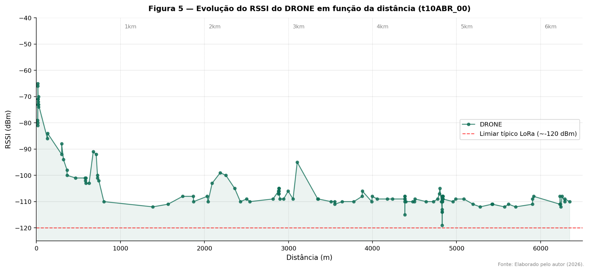
  <br><sub>Figure 5 — DRONE station RSSI as a function of distance in test t10ABR_00 (up to 6.3 km).</sub>
</p>

---

## System architecture

A mobile transmitter mounted on a vehicle periodically broadcasts its GPS position over LoRa. Each receiving station tags the packet with its own ID and the measured RSSI, then forwards it over Wi-Fi/TCP to a ground computer. There, a server validates every record and saves it to CSV.

```
                                ┌──> SOLO     (ESP32, house rooftop)       ──┐
  Mobile transmitter            │                                            │
  ESP32 + GPS ───── LoRa 915 ───┼──> DRONE    (ESP32, carried by the RPAS) ──┼── Wi-Fi / TCP:5001 ──> servidor.py
  (on vehicle)       SF12       │                                            │    + 5 s heartbeat           │
                                └──> ANTENA1  (ESP32, ground reference*)   ──┘                              │
                                                                                                      ┌─────┴─────┐
                                 each receiver appends                                              valid      invalid
                                 [RECEIVER_ID][RSSI]                                                   │           │
                                                                                                     CSV       error log
                                                                                                       │
                                                                                             processamento_kml.py
                                                                                                       │
                                                                                               KML (Google Earth)
```
<sub>* ANTENA1 took part in session t11ABR_00 only.</sub>

The RPAS moved **only along the vertical axis**: it changed altitude without moving horizontally, so elevation was the variable under test for the DRONE station.

### Hardware

| Component | Role |
|---|---|
| Heltec **WiFi LoRa 32 V2** (ESP32 + SX1276 + SSD1306 OLED) | Transmitter and receivers |
| GY-GPSV3 GPS module (u-blox NEO), UART2, 9600 baud | Transmitter |
| RPAS (drone) | Lifts the DRONE station |
| Computer with Python 3 | TCP server and KML generation |

### Radio parameters

| Parameter | Value |
|---|---|
| Frequency | 915 MHz (902–928 MHz ISM band, Anatel) |
| Spreading factor | SF12 |
| Bandwidth | 125 kHz |
| Coding rate | 4/5 |
| TX power | 20 dBm |

Frequency, spreading factor and TX power are set explicitly in the firmware. Bandwidth and coding rate are the Arduino LoRa library defaults and do not appear in the code. These parameters match the baseline study, so the results can be compared directly.

---

## Repository layout

```
LoRa-SARP/
├── artigo/
│   └── TCC_LoRa_SARP_Sara_Espanhol_2026.pdf   # Full paper (Portuguese)
├── firmware/
│   ├── heltec_transmitter/
│   │   └── heltec_transmitter.ino             # GPS + packet assembly + LoRa TX + OLED
│   └── heltec_receiver/
│       └── heltec_receiver.ino                # LoRa RX + RSSI + Wi-Fi + TCP forwarding + heartbeat
├── servidor/
│   ├── servidor.py                            # Multithreaded TCP server: validation and CSV logging
│   ├── processamento_kml.py                   # Follows the CSV and builds KML tracks
│   └── requirements.txt
└── docs/
    └── figuras/                               # Figures and tables from the paper
```

| File | Role |
|---|---|
| `heltec_transmitter.ino` | Reads the GPS (TinyGPSPlus), assembles the packet, transmits it over LoRa and shows status on the OLED. Includes a GPS simulator (`useFakeGPS`) and a packet corruptor (`corromperPacote`) for bench testing. Both are **disabled** in the build used in the field. |
| `heltec_receiver.ino` | Receives LoRa packets, measures RSSI, appends the station ID and forwards the result to the server over TCP. Sends a heartbeat every 5 s. |
| `servidor.py` | Accepts several stations at once (one thread per connection). Splits the TCP stream into messages on newlines, validates every field, writes valid records to CSV and sends invalid ones to an error log along with the rejection reason. Closes any connection that has been silent for more than 10 s. |
| `processamento_kml.py` | Follows the CSV during collection and writes a KML file with the latest position and the track of each device, for viewing in Google Earth or QGIS. |

Code comments and log messages are in Portuguese.

### Packet format

The transmitter sends:
```
<counter>[BRAVO][latitude][longitude][hdop][altitude][H:M:S]
```
Each receiver appends its own ID and the RSSI before forwarding:
```
<counter>[BRAVO][lat][lon][hdop][alt][H:M:S][DRONE][-104]
```
The server writes these CSV columns, **with no header row**:
```
id_pack, device, lat, lon, hdop, alt, time, receptor_id, rssi
```

---

## How to reproduce

### 1. Firmware (Arduino IDE)

1. Install the **ESP32** board package and select **Heltec WiFi LoRa 32 (V2)**.
2. Install these libraries:
    - `LoRa` (Sandeep Mistry)
    - `TinyGPSPlus` (Mikal Hart), transmitter only
    - `ESP8266 and ESP32 OLED driver for SSD1306 displays` (ThingPulse), which provides `SSD1306Wire.h`
3. **Transmitter:** flash `firmware/heltec_transmitter`. The GPS connects to RX = GPIO 32 and TX = GPIO 33. Make sure `useFakeGPS = false`.
4. **Receivers:** in `firmware/heltec_receiver/heltec_receiver.ino`, set:
    - `ssid`, `password` and `server_ip` (the IP of the computer running the server);
    - `RECEPTOR_ID` (`"SOLO"`, `"DRONE"` or `"ANTENA1"`) **and** the string in `sendHeartBeat()` (`"HEARTBEAT_<ID>"`), which is also hardcoded.

    Flash one board per station.

LoRa radio pins (same on both boards): NSS = 18, RST = 14, DIO0 = 26.

### 2. Server

```bash
cd servidor
pip install -r requirements.txt

# Terminal 1: receive data from the stations on port 5001
python servidor.py

# Terminal 2: build the live KML track
python processamento_kml.py
```

> Output file names are hardcoded and follow the session naming pattern (`t02ABR_00.csv`, `e02ABR_00.log`, `t02ABR_00.kml`). Change them in both scripts before each new session. Start `servidor.py` **before** `processamento_kml.py`, because the second script needs the CSV to exist already.

The server only accepts records inside a geographic window covering the Campinas region of São Paulo state (latitude −25.5 to −19.5; longitude −53.5 to −44.0). To test elsewhere, adjust `LAT_MIN/MAX` and `LON_MIN/MAX` in `servidor.py`.

---

## Experiments

Nine open-field sessions were run between **March 27 and April 11, 2026**. Session names follow the pattern `t<day><MONTH>_<n>`, with Portuguese month abbreviations (MAR = March, ABR = April).

| Session | Type | SOLO | DRONE | ANTENA1 | Total | Max. distance |
|---|---|---:|---:|---:|---:|---:|
| t27MAR_00 | proximity | — | 49 | — | 49 | 40.5 m |
| t27MAR_01 | proximity | 36 | 36 | — | 72 | 15.1 m |
| t27MAR_02 | operational | 91 | 113 | — | 204 | 731.9 m |
| t28MAR_00 | operational | 88 | 88 | — | 176 | 3,557.4 m |
| t28MAR_01 | proximity | 16 | — | — | 16 | 14.5 m |
| t02ABR_00 | operational | 59 | 59 | — | 118 | 642.5 m |
| t02ABR_01 | operational | 20 | 20 | — | 40 | 688.9 m |
| t10ABR_00 | operational | 35 | 138 | — | 173 | **6,345.8 m** |
| t11ABR_00 | operational | 29 | 193 | 76 | 298 | 6,116.2 m |
| **Total** | | | | | **1,146** | |

The **proximity tests** (under 50 m) took place during takeoff, landing and calibration. They are analyzed separately and should not be used to draw conclusions about the operational link.

Full RSSI statistics per session and station (mean, min, max, standard deviation and distances) are in Table 2 of the paper (in Portuguese):

<p align="center">
  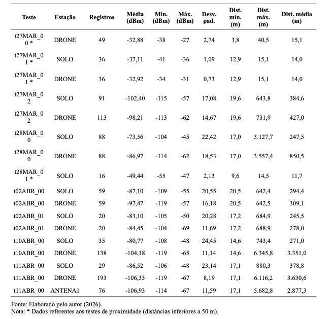
</p>

### Figures

<p align="center">
  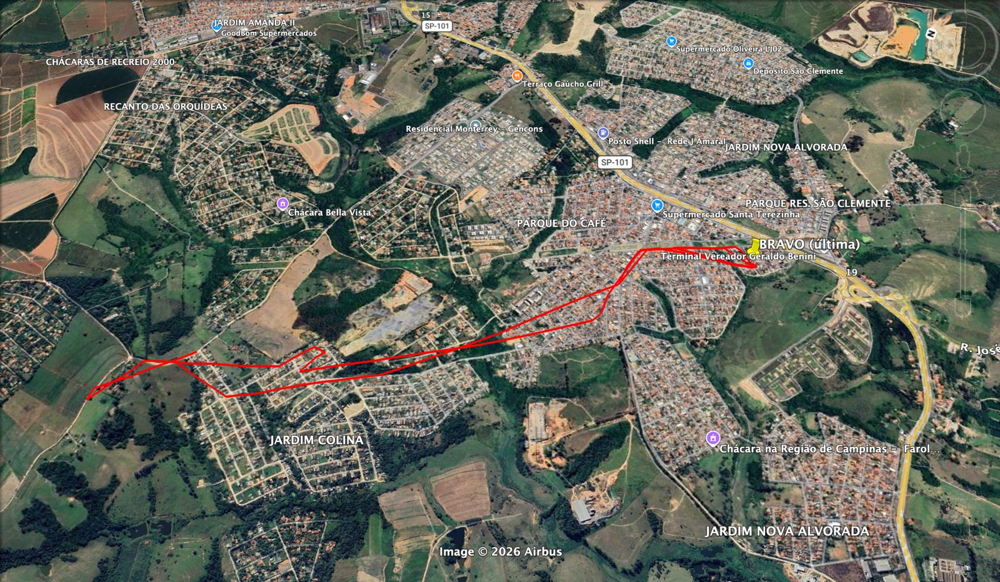
  <br><sub>Route driven by the transmitter vehicle in one of the sessions (KML generated by <code>processamento_kml.py</code>).</sub>
</p>

<p align="center">
  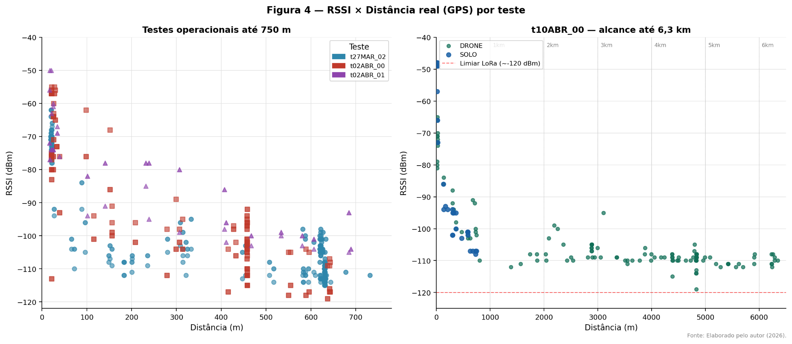
  <br><sub>Figure 4 — RSSI vs. actual GPS distance: tests up to 750 m (left) and t10ABR_00 up to 6.3 km (right).</sub>
</p>

<p align="center">
  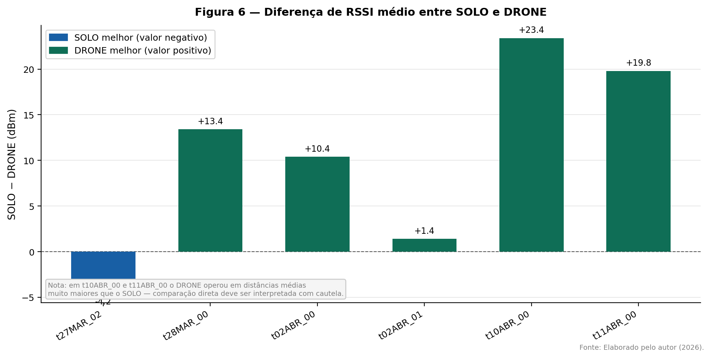
  <br><sub>Figure 6 — Mean RSSI difference (SOLO − DRONE) per operational session.</sub>
</p>

<p align="center">
  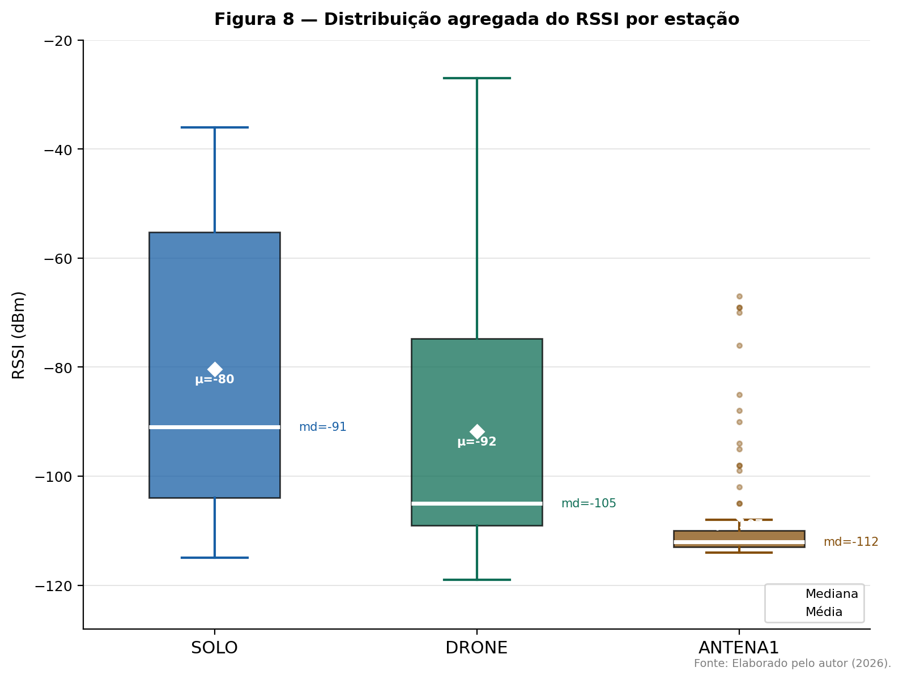
  <br><sub>Figure 8 — Aggregate RSSI distribution per station (median: SOLO −91 dBm, DRONE −105 dBm).</sub>
</p>

<details>
<summary><b>More figures from the paper</b></summary>

| | |
|---|---|
| 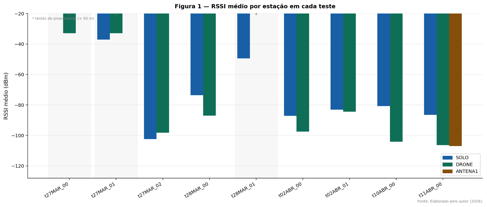 Figure 1 — Mean RSSI per station | 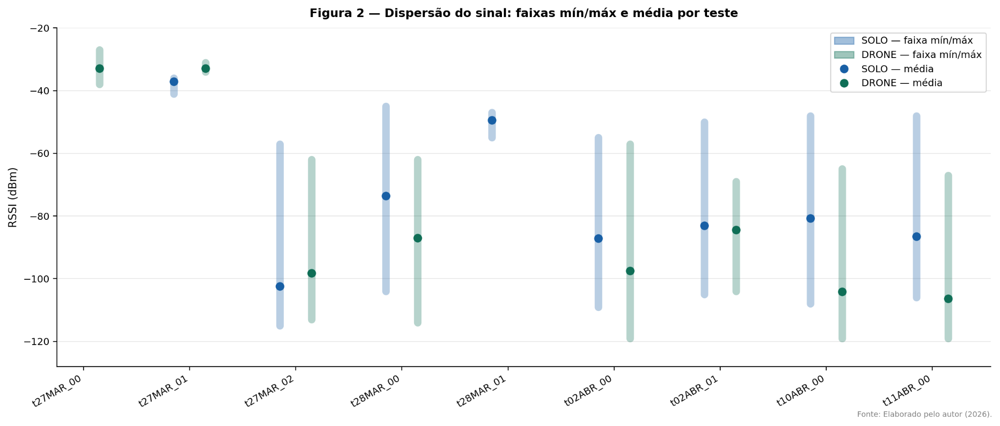 Figure 2 — Signal spread |
| 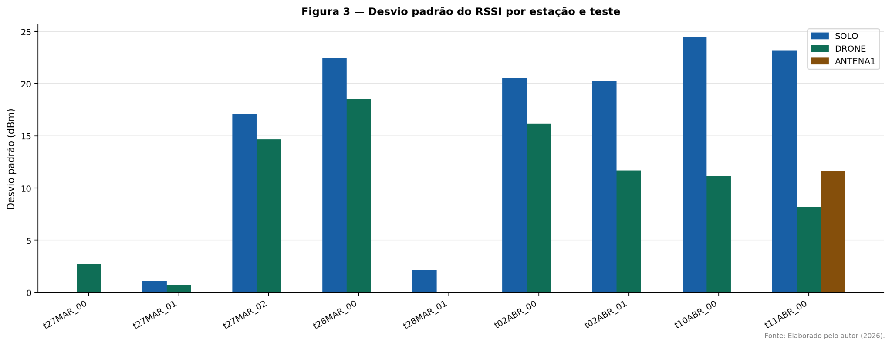 Figure 3 — RSSI standard deviation | 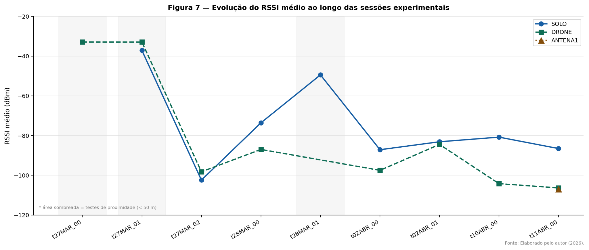 Figure 7 — Change over time |
| 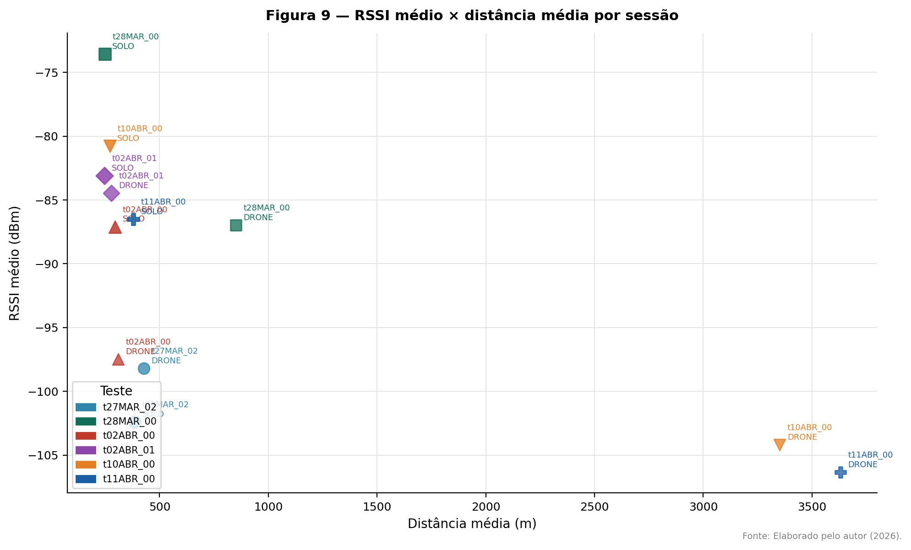 Figure 9 — Mean RSSI vs. mean distance | 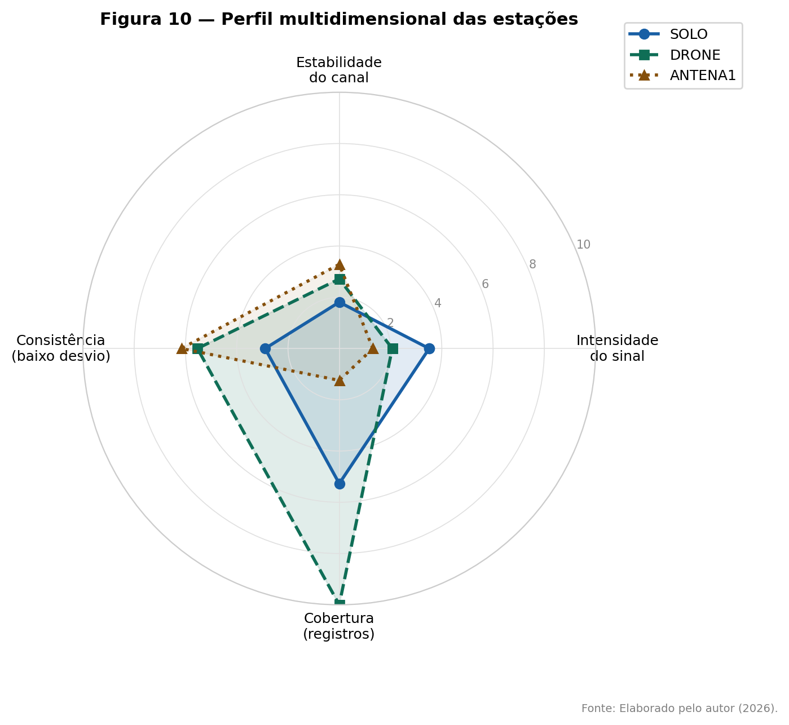 Figure 10 — Multidimensional profile |

</details>

---

## References

- ESPANHOL, J. P. H. W.; ANDRADE, H. Â. C.; HABERMANN, D.; BALTHAZAR, G. R. *IoT no Comando e Controle: análise técnica da transmissão de dados em aplicações militares utilizando microcontrolador WiFi LoRa.* XXVII SIGE, Instituto Tecnológico de Aeronáutica, São José dos Campos, 2025. **(baseline study)**
- DAMBAL, G.; MOHANTY, S. P.; KOUGIANOS, E. Improving LoRa signal coverage using UAVs for Internet of Things applications. *Sensors*, v. 19, n. 6, 2019. https://doi.org/10.3390/s19061348
- BIANCO, G. et al. FlyingLoRa: UAV-assisted LoRa networks for data collection in Internet of Things. *Computer Networks*, v. 212, 2022. https://doi.org/10.1016/j.comnet.2022.109041
- ZHANG, M. et al. Drone-enabled Internet-of-Things relay for environmental monitoring in remote areas without public networks. *IEEE Internet of Things Journal*, v. 7, n. 8, 2020. https://doi.org/10.1109/JIOT.2020.2988249

The full reference list is in the [paper](artigo/TCC_LoRa_SARP_Sara_Espanhol_2026.pdf).

## Credits

Research, experiments and analysis: **Sara de O. N. Wandermuren Espanhol**, **João Pedro de H. W. Espanhol** and **Henrique Ângelo Censi de Andrade**.<br>
The firmware and server build on the baseline architecture and were developed jointly by the three authors.<br>
Advisor: Prof. Dr. Glauber da Rocha Balthazar (IFSP Campinas). Co-advisor: Col. Danilo Habermann.

<details>
<summary><b>Resumo (Português)</b></summary>

A crescente digitalização do ambiente operacional militar tem impulsionado o emprego de redes de Internet das Coisas (IoT) como tecnologia habilitadora do Sistema Militar de Comando e Controle (SISMC²). Este artigo avalia experimentalmente o desempenho de uma rede IoT de longo alcance baseada em módulos LoRa embarcados em um Sistema Aéreo Remotamente Pilotado (SARP), em continuidade ao estudo de Espanhol et al. (2025), que identificou as obstruções topográficas como o principal fator limitante do enlace LoRa terrestre. Foram realizadas nove sessões de testes em campo aberto entre 27 de março e 11 de abril de 2026, com módulos WiFi LoRa 32 V2 operando em 915 MHz, fator de espalhamento 12, largura de banda de 125 kHz e potência de transmissão de 20 dBm. Um transmissor móvel acoplado a um veículo automotor enviou pacotes periódicos a três estações receptoras — uma terrestre fixa (SOLO), uma embarcada no SARP (DRONE) e uma de referência em solo (ANTENA1), totalizando 1.146 registros de intensidade do sinal recebido (RSSI) associados à distância real calculada por GPS. Os resultados indicam enlace operacional contínuo em distâncias de até 6.345,8 m, valor 58% superior ao alcance máximo do trabalho base, sem perda total de enlace em nenhuma das distâncias avaliadas. Conclui-se que a elevação do módulo receptor amplia significativamente a cobertura da rede, ainda que a atribuição exclusiva desse ganho à altitude seja limitada pela diferença entre os ambientes de teste.

</details>
